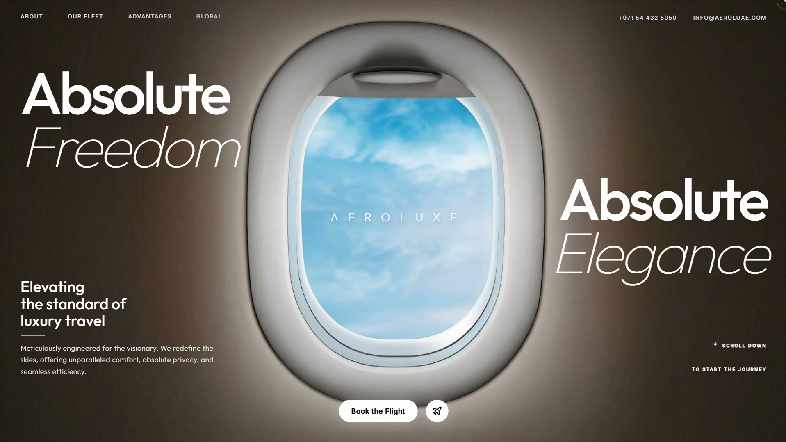

# AeroLuxe

A cinematic, scroll-driven landing page for a private jet charter brand, built with **React**, **TypeScript**, and **Tailwind CSS**. Combines a canvas-based frame-sequence animation with buttery-smooth scrolling to create an immersive, editorial-style luxury aviation experience.



🔗 **Live Demo:** https://aeroluxe-wb.vercel.app/


---

## About the Project

AeroLuxe is a fictional private jet charter brand landing page designed to showcase high-end front-end animation and layout techniques inspired by luxury/product marketing sites. It features:

- **Scroll-Driven Frame Sequence**: 281 sequential frames rendered on an HTML5 canvas (`CanvasScroll.tsx`), scrubbed in sync with scroll position to simulate a smooth 3D jet reveal
- **Buttery Smooth Scrolling**: powered by [Lenis](https://github.com/darkroomengineering/lenis) for inertia-based scroll
- **Custom Cursor**: a mix-blend-mode dot-and-ring cursor that expands over links and buttons
- **Fade-In Reveal Animations**: sections animate into view using `IntersectionObserver` (`FadeIn` component)
- **Fleet Specifications**: a detailed aircraft spec sheet (range, top speed, capacity, dimensions) with a sticky scroll layout
- **Interactive Advantages Accordion**: expandable list of service advantages (Pets, 24/7 Availability, Onboard Services, Efficiency) paired with a crossfading image panel
- **City Ticker & Live Clock**: an animated scrolling city list and a real-time clock (Dubai timezone)
- **Global Stats & Radar Visual**: a decorative animated "radar/globe" visual with mission stats and a scrolling world map background
- **Sticky Booking CTA**: a floating "Book the Flight" button fixed to the viewport

## Tech Stack

| Category | Technology |
|---|---|
| Frontend | React 19, TypeScript, Vite 8 |
| Styling | Tailwind CSS 4 |
| Smooth Scroll | Lenis |
| Icons | Lucide React |
| Rendering | HTML5 Canvas API |
| Linting | oxlint |

## Project Structure

```
Aeroluxe-main/
├── public/
│   ├── frames/                  # 281 sequential JPG frames for the scroll animation
│   └── images/                  # Advantage section images (jet, pets, onboard, clouds)
├── src/
│   ├── components/
│   │   └── CanvasScroll.tsx     # Canvas frame preloader & scroll scrubber
│   ├── assets/
│   ├── App.tsx                  # Page layout: hero, about, fleet, advantages, global sections
│   ├── App.css
│   ├── index.css
│   └── main.tsx
├── tailwind.config.js (via @tailwindcss/vite)
└── vite.config.ts
```

## Getting Started

1. **Clone the repository**
   ```bash
   git clone https://github.com/WarrenBillTT/Aeroluxe.git
   cd Aeroluxe
   ```

2. **Install dependencies**
   ```bash
   npm install
   ```

3. **Run the development server**
   ```bash
   npm run dev
   ```
   Open [http://localhost:5173](http://localhost:5173) in your browser.

4. **Build for production**
   ```bash
   npm run build
   ```

5. **Preview the production build**
   ```bash
   npm run preview
   ```

## Available Scripts

| Command | Description |
|---|---|
| `npm run dev` | Starts the development server with HMR |
| `npm run build` | Type-checks and builds the project for production |
| `npm run lint` | Runs oxlint |
| `npm run preview` | Previews the production build locally |

## Notes

- The animation frames in `public/frames/` are sourced from a GIF-to-frames conversion (`ezgif-frame-XXX.jpg`) and total 281 images — keep this in mind for repo size and load performance.
- "AeroLuxe" is a fictional brand created for this project as a design/animation case study and is not a real aviation company.

## License

This project was built for personal/educational use as a front-end design and animation study. Feel free to use it as a reference, but please don't copy it identically for your own portfolio.
